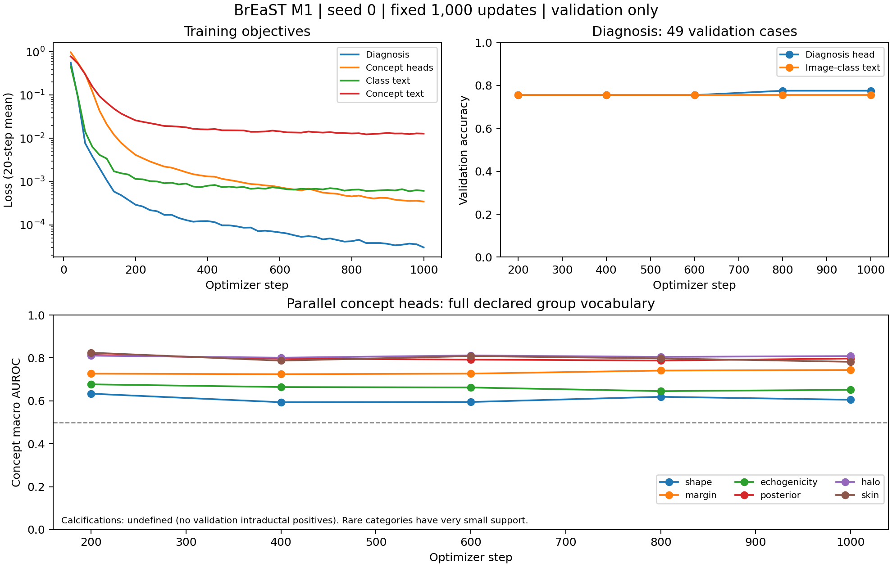

# M0/M1 实验报告

日期：2026-10-04；范围：一个真实概念锚点的单任务可行性。M2 与 M3 未运行。

## 实际完成情况

M0：11 个原始分类任务和 BrEaST 已完成路径、类别、split 与标注结构核对。原 11 任务均不含图像级概念；BrEaST 作为 C 级训练锚点，病例划分在训练前锁定。详见 DATA_AUDIT.md。

M1：独立实现 BiomedCLIP 并行头、7 组概念、固定词表图文监督、掩码 CE/BCE、评价器和恢复机制。27 项合成/工程测试通过；真实 BUSI 与 BrEaST 小样本检查通过。BrEaST 单任务按预定 1,000 optimizer updates 完成。测试集从未进行模型评价。

## 三次实际运行

| 运行 | 监督 | updates | 用时（秒） | 峰值 CUDA 分配（GiB） |
|---|---|---:|---:|---:|
| BUSI smoke/overfit | 诊断/类别文本 | 100 | 42.66 | 3.191 |
| BrEaST smoke/overfit | 诊断/真实概念/图文 | 100 | 46.23 | 3.190 |
| BrEaST single-task | 诊断/真实概念/图文 | 1000 | 489.79 | 3.694 |

用时来自实际进程，包含模型载入、评价和 checkpoint 保存；CUDA 数字是 PyTorch max_memory_allocated，不等于整卡 nvidia-smi 占用。训练 seed 仅 0，无多种子方差。

BUSI：155 例验证集的原始图文零样本 ACC 41.9%，AUROC 0.7505。24 个训练图（每类 8 个）过拟合后诊断 ACC 100%。BUSI 没有概念标注，仅为分类工程检查。

BrEaST：原始图文零样本验证 ACC 49.0%，AUROC 0.6746。24 个训练病例（每类 12 个）100 步后，诊断与各概念组有效标注准确率均为 100%。这是记忆检查，并不证明未出现的概念值或泛化能力。正式训练重新载入原始 checkpoint，没有延续 smoke 权重。

## 固定第 1,000 步：49 个验证病例

| 分支 | ACC | BACC | Macro F1 | AUROC |
|---|---:|---:|---:|---:|
| 诊断头 | 0.7755 | 0.7298 | 0.7405 | 0.7789 |
| 图像—类别文本 | 0.7551 | 0.7035 | 0.7118 | 0.8053 |
| 训练多数类常量 | 0.6122 | 0.5000 | 0.3797 | 0.5000 |

诊断 ACC 的 Wilson 95% 区间：[64.1%, 87.0%]；这是病例抽样不确定性，不是不同训练种子的方差。没有挑验证曲线最佳步，也没有阈值优化。

| 概念组 | 头 AUROC | 头 F1 | 头 ACC | ACC 95% 病例 bootstrap | 训练多数值 ACC | 图文 AUROC |
|---|---:|---:|---:|---|---:|---:|
| shape | 0.6051 | 0.4135 | 0.6327 | [0.4898, 0.7556] | 0.5306 | 0.7346 |
| margin | 0.7439 | 0.3969 | 0.7918 | [0.7346, 0.8449] | 0.7429 | 0.7655 |
| echogenicity | 0.6514 | 0.1270 | 0.4694 | [0.3265, 0.6122] | 0.4898 | 0.6803 |
| posterior | 0.7974 | 0.4560 | 0.7959 | [0.6735, 0.8980] | 0.6939 | 0.7814 |
| halo | 0.8087 | 0.4545 | 0.7551 | [0.6327, 0.8776] | 0.6735 | 0.7585 |
| calcifications | NA | NA | 0.9388 | [0.8571, 1.0000] | 0.9388 | NA |
| skin | 0.7819 | 0.0000 | 0.9592 | [0.8980, 1.0000] | 0.9592 | 0.5851 |

病例 bootstrap：1,000 次，固定随机种子 20261004；多标签的五个属性随病例整体重采样。二元 F1 针对阳性类别，margin F1/AUROC 为五属性平均；类别型为完整词表宏平均。不同类型 F1 不直接合成一个总分。钙化验证集无 intraductal 正例，完整字典 AUC/F1 为 NA；高 ACC 大多来自无钙化多数类。逐值正负支持及逐值 AUC 见 results JSON。

## 科学结论与退出边界

第 1,000 步的关键负结果：echogenicity ACC 0.4694、宏 F1 0.1270，ACC 低于训练多数值常量的 0.4898；skin ACC 0.9592 与多数阴性常量一致，阳性 F1 为 0，说明两个验证阳性均未在 0.5 阈值下检出。shape 宏 AUROC 仅 0.6051。不能因整体诊断或多数类准确率尚可就开始解释这些概念的遗忘。

概念损失与评价链路已在真实标注上运行，但小样本、罕见征象和不均衡限制了总体结论。应逐组查看相对固定多数值基线与零样本图文表现，不能把所有概念统称为已可靠学会。M1 的工程交付已完成；concept_stage_gate_passed 保持 false，表示尚未据此接受并启动 M2，不是系统异常。

当前没有遗忘、保持机制收益或诊断依据保持的证据。诊断头与概念头并行，仅有预测相关性；尚未做瓶颈结构、oracle 概念纠正或区域干预。

## 实现差异、验证与异常

MedCBR 参考 commit、许可问题和架构差异见 ENVIRONMENT.md。当前冻结文本、全图补边、无 LLM、无 ROI、固定概念词表与 typed missing masks；并非原论文完整复现。

结构测试覆盖：患者/路径跨 split，mask 排除，missing/NA 不产负监督，分组 CE/BCE 与无标注零损失，重复描述共享正类，旧头不重置，teacher 无梯度/同权重 KD 近零，错教师屏蔽，概念 ID 对齐，共享 replay IDs，CPU stochastic checkpoint 恢复，以及推理不接受真实标签/文件名。CPU 恢复一致不证明跨硬件 GPU bitwise 一致。

保留的异常与负结果：Derma/OCT 上游 train 数各与 README 差 1；初次 XLSX 探索按论文 Case_ID 字段读取触发 KeyError，核对实际表头 CaseID 后修正（发生于划分和训练之前）；单类/罕见类别评分产生 sklearn 支持数警告，相应不定义指标保留 NA；列出的三次训练均完成，未在这些运行中记录到 NaN 或 OOM。稀有征象缺少支持不是通过填 0 修复。

## 实际入口与文件

实际执行通过 SSH 的 Python stdin 载入审计、unittest、模型载入与启动器；配置中的路径通过环境变量展开，中性 job_*.py 子进程启动训练。私有 launch.json/config/source_snapshot 留存真实命令、PID 与绝对位置；公开版的可运行等价入口见 README。每次启动均检查 GPU 显存，BrEaST 两次运行的 ps/nvidia-smi 均确认中性入口。BUSI 短作业在查询时已完成，留存运行时 PID、入口与完整日志，不声称捕获了其运行中的 GPU 列表。

新增核心文件：core.py、concepts.py、run_single.py、tools/audit_classification.py、tools/audit_breast.py、tools/launch.py、tools/summarize_run.py、tools/plot_run.py、真实 JSON 配置、概念 schema、数据审计/缺口/假设/环境报告与 results。原启动包示例、研究计划和合成 SELF_TEST_LOG 单独保留。

公开源代码、可移植配置、聚合指标和学习曲线；原始图像、临床表、manifest/病例 ID、逐病例预测、checkpoint、凭据和私有路径均留在用户环境。
